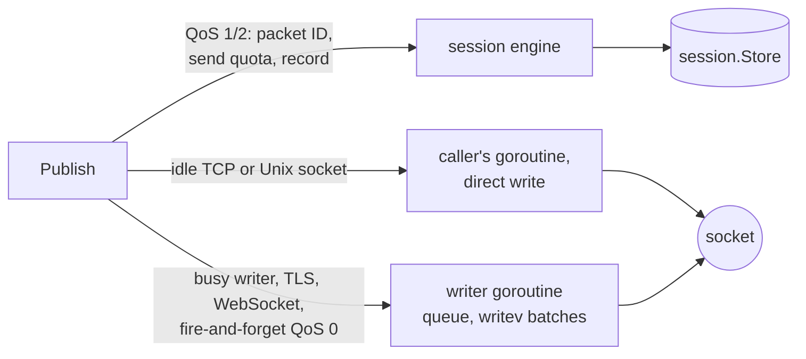
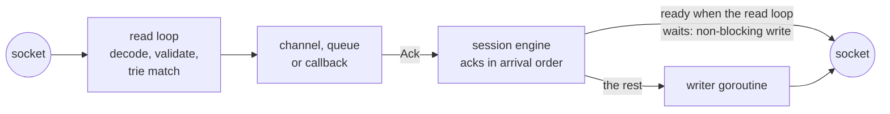

# Architecture

[Documentation](README.md) · [API reference](https://pkg.go.dev/github.com/ashtonian/mqttv5) · [Examples](../examples/README.md)

Outbound, a publish takes the shortest path the connection allows:

Inbound, acknowledgements leave in arrival order, from the read loop
itself when the socket takes them:

One goroutine per connection drives
`read → decode → trie match → handlers (sync)`. On a TCP or Unix
connection, a publish that waits for its write (QoS 1/2, or QoS 0 with
`PublishWaitForFlush`) writes on its own goroutine when nothing is
queued: a QoS 0 header and its payload in one `writev`, without copying
the payload; a QoS 1/2 publish the packet the session keeps for
retransmission. If the caller's ctx ends mid-write, a deadline stops
the write and the writer goroutine sends the rest before anything else.
Otherwise — TLS and WebSocket connections, a busy writer, and
fire-and-forget QoS 0 — one writer goroutine per connection drains an
MPSC channel of encoded packets to the socket, coalescing queued
packets into one `writev` when `WithWriteBatch` is set; a write lock
keeps the two paths from interleaving, and a publish never overtakes a
packet its caller queued earlier. Before the read loop waits for more
input, it writes the acknowledgements and PUBRELs it has made ready
itself — on an idle TCP or Unix connection, on unix systems — as far as
the socket takes them without waiting; the writer goroutine sends the
rest, so a broker that stops reading never stops the client reading. A
supervisor goroutine owns the connection lifecycle: reconnect with
backoff, session resumption, and re-issuing subscriptions.

**Frames.** The decoder reads through a `WithReadBufferSize` window
(16 KiB). A body up to 64 KiB goes into a pooled frame from one of five
size classes (256 B – 64 KiB). A larger body is read into buffers that
grow as its bytes arrive — never more than eight times what the broker
has actually sent — and the final buffer is never pooled. A declared
length therefore costs nothing until its bytes arrive;
`WithMaximumPacketSize` rejects oversized packets before reading them.

**Messages.** A delivered message copies topic, payload and properties
out of a pooled frame into one exact-size buffer before any handler
runs, so the frame goes back to its pool at once. A message read into
an unpooled frame keeps that frame instead of copying it. `SubZeroCopy()`
subscriptions alias the pooled frame and release it when the last
handle is acked.

**Session engine** (`internal/inflight`). Owns packet identifiers, the
send quota (the broker's Receive Maximum), outbound and inbound QoS 1/2
state machines, ordered acknowledgements, replay on resumption, and
writes to the `session.Store`. Store writes run off the read goroutine
and are drained on `Disconnect`.

**Subscriptions.** One broker subscription per exact filter, shared by
the client's subscriptions with that filter; a topic trie maps topics
to them, and Subscription Identifiers select the subscriptions a
PUBLISH was sent for. SUBSCRIBE and UNSUBSCRIBE go through one ordered
control queue that survives reconnects.

---

# Code map

| Path | What |
|---|---|
| `client.go` | `Client`, `New`, `ServerInfo` (what CONNACK granted), `Stats` counters |
| `options.go` | `Config`, every `With…` option |
| `backoff.go` | `Backoff` and the policies: `ExponentialBackoff`, `ConstantBackoff`, `BackoffFunc` |
| `lifecycle.go` | `Connect`/`Disconnect`, the supervisor, lifecycle callbacks and their queue, server redirects |
| `conn.go`, `conn_unix.go`, `conn_other.go` | per-connection state: read loop and dispatch, writer goroutine, direct writes, keep-alive; the non-blocking socket write on unix |
| `auth.go` | `Authenticator` interfaces, AUTH handling, `Reauthenticate` |
| `publish.go` | `Publish`, broker-limit checks, publisher pool |
| `subscribe.go`, `subscription.go` | subscribe API with its results and tokens, `Message` and its delivery, `Queue[T]`; the subscription registry and control queue |
| `queue_publisher.go` | `QueuePublisher`, the `PublisherQueue` interface and its in-memory implementation |
| `client_group.go` | `ClientGroup` |
| `types.go` | public value types and errors |
| `encoding.go` | `Encoding` and the typed calls: `PublishValue`, `SubscribeAs` and their variants, `TypedMessage` |
| `doc.go` | package documentation |
| `*_test.go` | a test file per source file, plus `helpers_test.go`, `session_test.go` (sessions and stores across connections), `bench_test.go`, `example_test.go` and `readme_test.go` |
| `internal/inflight` | session engine: packet identifiers, QoS 1/2 state, quota, replay, store writes |
| `internal/trie` | topic trie |
| `internal/clock`, `internal/testbroker` | injectable clock; scripted and raw brokers for tests |
| `internal/filedb` | bbolt wrapper with group commit, shared by `store/file` and `queue/file` |
| `session`, `session/storetest` | `Store` interface, memory store, conformance tests for stores |
| `queue/queuetest` | conformance tests for `PublisherQueue` implementations |
| `wire` | MQTT v5 codec (unstable API) |
| `transport`, `transport/ws` | TCP/TLS dialing; WebSocket |
| `store/file`, `queue/file` | durable session store and publish queue |
| `codec/json`, `codec/msgpack` | `Encoding` implementations |
| `conformance` | tests against real brokers (`-tags conformance`) |
| `benchmarks` | head-to-head benchmarks, raw results, `benchtab` |
| `examples`, `examples/readme` | runnable examples, run against the conformance brokers by `examples/smoke_test.go` (`-tags smoke`); the README and guides' snippets as compiled code |
