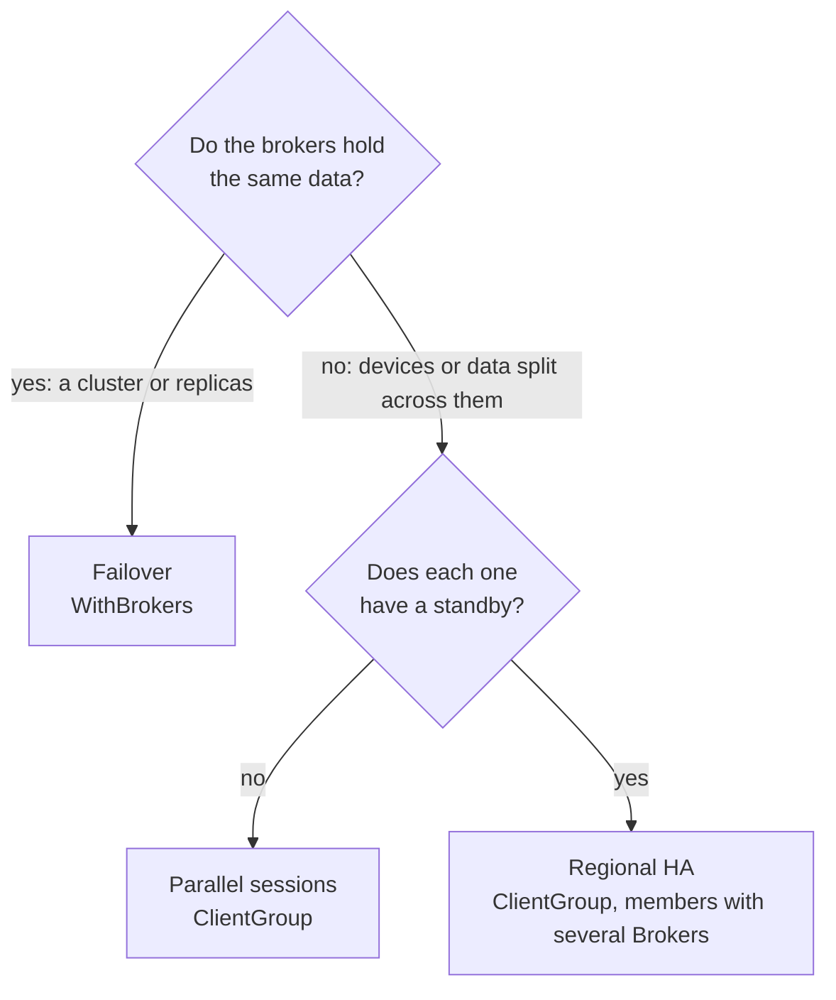
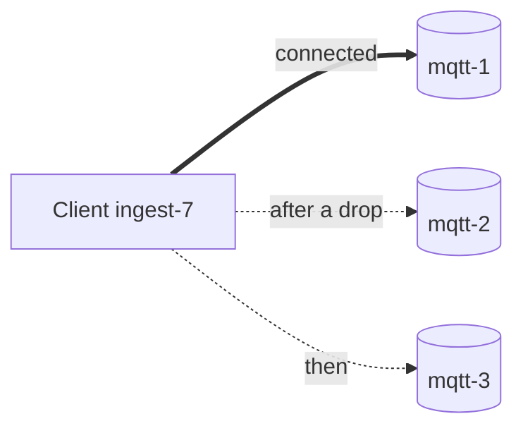
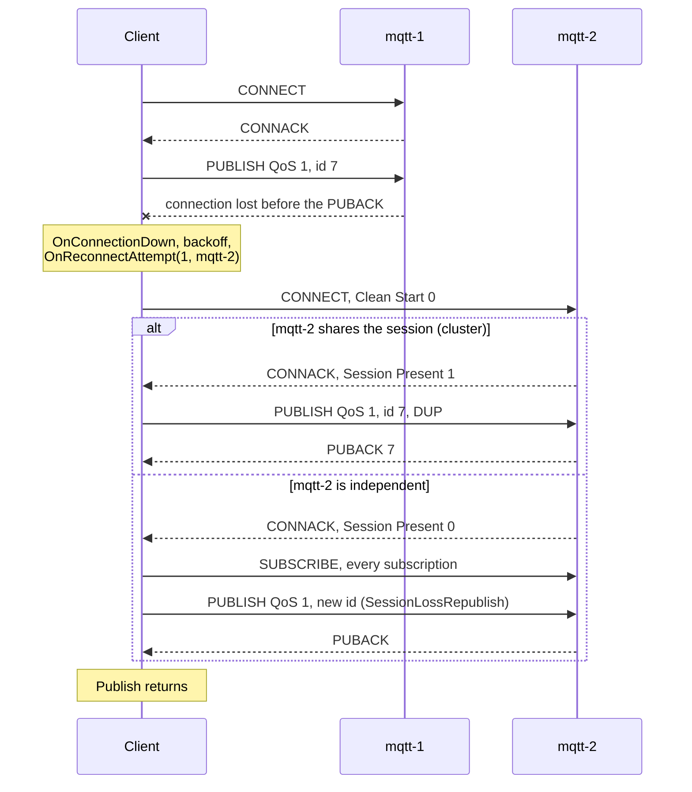
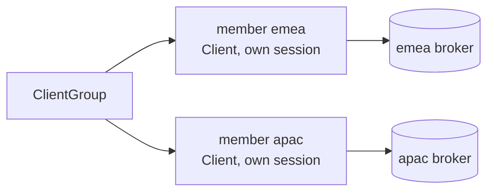

# Multiple brokers

[Documentation](README.md) · [API reference](https://pkg.go.dev/github.com/ashtonian/mqttv5) · [Examples](../examples/README.md)

- [Failover: `WithBrokers`](#failover-withbrokers)
- [Parallel sessions: `ClientGroup`](#parallel-sessions-clientgroup)

One connection reaches one broker. Services outgrow that for two
reasons, and each has an API of its own:

- **No single broker may take the service down.** Brokers that carry
  the same data — the nodes of a cluster, or replicas — are
  interchangeable, so one client connects to whichever is up:
  [failover](#failover-withbrokers).
- **The data is spread over brokers that do not share it.** Devices
  connect to whichever of two independent clusters is up or nearer,
  regions or tenants have brokers of their own, or a fleet is moving
  from one broker to another. A central service needs a session on each:
  one publish reaches all of them and one subscription hears from all
  of them: [parallel sessions](#parallel-sessions-clientgroup), as in
  [central service over independent clusters](recipes.md#central-service-over-independent-clusters).

Which one fits depends on how the brokers relate to each other:

| Pattern | API | Connections | The brokers |
|---|---|---|---|
| [Failover](#failover-withbrokers) | `WithBrokers(urls...)` | one at a time | are interchangeable: nodes of a cluster, or replicas |
| [Parallel sessions](#parallel-sessions-clientgroup) | `NewClientGroup(members, opts...)` | one per member, all live | are independent: each holds its own data |



Publishing faster than one connection allows is a separate question,
with the same answer for one broker or many: a
[publish pool](publisher-pool.md#publish-pool-withpublisherpool) opens more connections
to the brokers the client already uses.

They compose: a `ClientGroup` member is a full `Client`, so it can fail
over between brokers of its own and carry its own publish pool
([What combines](#what-combines)). The [recipes](recipes.md#recipes) build on
them: a central service over independent clusters, a bridge that loses
nothing, quorum writes, sharding with fan-in, a durable outbox, brokers
from service discovery, and consumers scaled out with shared
subscriptions.

## Failover: `WithBrokers`

One client, one session identity, one connection at a time, moving
between brokers that carry the same data.



```go
cli, _ := mqttv5.New(
    mqttv5.WithBrokers(
        "mqtts://mqtt-1.example.com:8883",
        "mqtts://mqtt-2.example.com:8883",
        "mqtts://mqtt-3.example.com:8883",
    ),
    mqttv5.WithClientID("ingest-7"),
    mqttv5.WithOnConnectionUp(func(info mqttv5.ConnackInfo) {
        log.Printf("connected to %s, session present: %v", info.Broker, info.SessionPresent)
    }),
    mqttv5.WithOnReconnectAttempt(func(attempt int, broker string) {
        log.Printf("reconnect attempt %d: %s", attempt, broker)
    }),
)
```

- **Connect.** Each client starts at a random entry, so a fleet that
  restarts together spreads over the list ([`FailoverPriority`](#primary-and-standby-failoverpriority)
  starts at the first instead). `Connect` tries each broker
  once and fails only when none accepts; its error joins every
  broker's, each naming its URL, and `errors.Is` sees them all. With
  `WithRetryInitialConnect` the client keeps trying in the background
  instead.
- **A drop.** After the reconnect backoff the supervisor dials the next
  entry, so the first attempt leaves the broker that just failed, and
  each further attempt moves on one ([`FailoverPriority`](#primary-and-standby-failoverpriority)
  starts each attempt at the first entry instead). The client stays on whichever
  broker accepts it; `ConnackInfo.Broker`, in `OnConnectionUp` and
  `ServerInfo()`, names it.
- **The session.** Nodes of a cluster share sessions: the next one
  answers Session Present = 1, unacknowledged QoS 1/2 messages are
  resent with DUP set (QoS 2 stays exactly-once), and subscriptions
  stay in place. An independent broker has only the session it kept
  itself for this ClientID: usually none (Session Present = 0), so every
  subscription is subscribed again and unacknowledged publishes follow
  `WithSessionLossPolicy` — sent again as new messages (the default; a
  consumer may see a duplicate) or failed with `ErrSessionLost`. If it
  kept an older one from an earlier connection, that one resumes,
  messages it queued since included.
- **Callers.** A `Publish` waiting for its acknowledgement keeps waiting
  across the failover, bounded by its ctx. While no broker is
  connected, `Publish` returns `ErrNotConnected`, or with
  `WithPublishWaitForConnection()` waits for the broker it fails over
  to; a
  [`QueuePublisher`](durable-publishing.md#durable-publishing-with-queuepublisher) queues.



### Primary and standby: `FailoverPriority`

The brokers above are equals. When they are not, because one is the
primary and the rest stand by in a preference order, a site's own
broker before a remote one, say, `WithFailoverOrder(FailoverPriority)`
makes the list that order:

```go
cli, _ := mqttv5.New(
    mqttv5.WithBrokers(
        "mqtts://primary.example.com:8883",
        "mqtts://standby.example.com:8883",
    ),
    mqttv5.WithFailoverOrder(mqttv5.FailoverPriority),
    mqttv5.WithClientID("ingest-7"),
)
```

- **Connect** starts at the first entry, every time.
- **A reconnect attempt** is one pass over the list from the first
  entry, after the reconnect backoff. An entry that fails, by a dial
  error, a timeout or a CONNACK refusal such as `0x88` Server
  unavailable or `0x9C` Use another server, hands over to the next one at
  once; the backoff runs between passes, never between entries. A
  primary that refuses its clients, while it drains for maintenance for
  example, moves them to the standby in one pass.
- **Coming back.** A client on a standby stays there while the
  connection lasts and tries the primary first on its next reconnect.
  Nothing moves a healthy connection back.

`OnReconnectAttempt` reports each entry a pass dials, all with the
pass's attempt number.

### Changing brokers at runtime

A broker can send the client elsewhere ([§4.11]): a CONNACK or DISCONNECT
with reason `0x9D` Server moved or `0x9C` Use another server and a
Server Reference. `WithOnServerRedirect` reports each one;
`WithFollowServerRedirects()` acts on it — a move replaces the broker
list, a temporary redirect applies to the next connection attempt only.
A reference that is a bare `host` or `host:port` keeps the current URL's
scheme and path.

```go
cli, _ := mqttv5.New(
    mqttv5.WithBroker("mqtts://broker-a.example.com:8883"),
    mqttv5.WithFollowServerRedirects(),
    mqttv5.WithOnServerRedirect(func(r mqttv5.ServerRedirect) {
        log.Printf("redirected to %s (permanent=%v)", r.Reference, r.Permanent())
    }),
)
```

`Client.SetBrokers(urls...)` replaces the list from your side, for a
[publish pool](publisher-pool.md#publish-pool-withpublisherpool)'s connections too, from
service discovery for example ([recipe](recipes.md#brokers-from-service-discovery)).
The live connection stays where it is; the next connection attempt uses
the new list.

## Parallel sessions: `ClientGroup`

N sessions to N brokers, each member treated as itself:

- a central service for devices split across independent clusters:
  every command to all of them, every reply from any of them
  ([recipe](recipes.md#central-service-over-independent-clusters)),
- a migration from one broker to another, publishing to both until the
  devices have moved,
- bridges between independent brokers,
- multi-tenant SaaS with per-broker credentials.



Members never stand in for each other: if your brokers are
interchangeable for the same data, use `WithBrokers` on a single
`Client`. Pointed at one cluster, a group's members would each
subscribe to the same messages, so a merged subscription to a filter
that is not a shared subscription would deliver every message once per
member; for publish throughput into one broker
or cluster, use a [publish pool](publisher-pool.md#publish-pool-withpublisherpool). A member can have several `Brokers` of its own to fail over
between ([regional HA](recipes.md#regional-ha)).

Construction takes a `GroupMember` list plus group-level options:

```go
g, _ := mqttv5.NewClientGroup(
    []mqttv5.GroupMember{
        {
            Brokers: []string{"mqtts://emea.example.com:8883"},
            Name:    "emea",
            Opts:    []mqttv5.Option{mqttv5.WithCredentials("emea-svc", []byte(token1))},
        },
        {
            Brokers: []string{"mqtts://apac.example.com:8883"},
            Name:    "apac",
            Opts:    []mqttv5.Option{mqttv5.WithCredentials("apac-svc", []byte(token2))},
        },
    },
    mqttv5.WithGroupSharedOpts(
        mqttv5.WithClientID("fleet"),
        mqttv5.WithKeepAlive(30),
    ),
    mqttv5.WithGroupPublishPolicy(mqttv5.GroupPublishBroadcast),
)
```

`GroupMember.Opts` applies **after** `WithGroupSharedOpts`, so
per-member auth / TLS / ClientID / callbacks win; brokers come only
from `GroupMember.Brokers`, and `NewClientGroup` rejects `WithBroker` or
`WithBrokers` in either. Member names default to `member-N` (1-based)
when unset. A member whose ClientID another member already uses gets
the first free `-N` suffix (`-2`, `-3`, …); members without one have it
assigned by their broker.

`Publish` returns every member's outcome (`[]GroupResult`) and an
error decided by the policy below:

| Publish policy | Behaviour | Use case |
|---|---|---|
| `GroupPublishBroadcast` (default) | Publishes to every member at once and returns when each has answered or ctx ends. Fails with a `*GroupError` when fewer than `WithGroupSuccess` members succeed. | Bridge / mirror / quorum — members carry different data |
| `GroupPublishRoundRobin` | One member per call, the next each time. | Spread publishes over independent brokers whose consumers subscribe to all of them |
| `GroupPublishHashByTopic` | FNV-1a(topic) → member. Per-topic ordering. | Shard topics across independent brokers ([sharding with fan-in](recipes.md#sharding-with-fan-in)) |

RoundRobin and HashByTopic send each message once. They move to the
next member only when the chosen one could not send it at all (not
connected); a broker refusal or the ctx ending is returned as is, so a
message never goes out on two members.

| Success policy (`WithGroupSuccess`) | Broadcast Publish and Subscribe succeed when |
|---|---|
| `GroupSuccessAll` (default) | every member succeeded |
| `GroupSuccessAny` | at least one member succeeded |
| `GroupSuccessQuorum(n)` | at least `n` members succeeded |

```go
results, err := g.Publish(ctx, mqttv5.PublishOptions{Topic: "events/x", QoS: 1, Payload: p})
for _, r := range results {
    if r.Err != nil {
        log.Printf("%s: %v", r.Member, r.Err) // errors.Is(err, mqttv5.ErrNotAuthorized) works on the GroupError too
    }
}
```

Subscribe subscribes every member and merges their messages into one
channel or queue; `Ack` goes back to the member that delivered the
message. Delivery is direct from each member's read loop — no
forwarding goroutines — with the buffer, bound and drop policy of
`Client.Subscribe` / `SubscribeQueue` applied to the merged output.
When fewer members than the success policy requires subscribe, or ctx
ends, the members that did are unsubscribed again and the error is
returned. Otherwise the token map, keyed by member name, holds the
members that subscribed — pass it to `UnsubscribeAll`, or one entry to
`Unsubscribe(name, token)`. The merged output closes once every member's
subscription has ended (unsubscribed, refused, or `Disconnect`).

```go
ch, tokens, err := g.Subscribe(ctx, []mqttv5.TopicFilter{{Topic: "events/#", QoS: 1}})
// tokens["emea"], tokens["apac"]
defer g.UnsubscribeAll(ctx, tokens)
```

A member whose connection drops reconnects on its own, to its own
brokers, while the others carry on; each member's subscriptions come
back with it.

Connect / Disconnect / Subscribe run in parallel across members by
default. Pass `WithGroupSequentialLifecycle` if you need deterministic
ordering. A group is used once: after `Disconnect` its methods return
`ErrClosed`.

Use `g.Members()` or `g.Member(name)` for direct per-member access
(per-member `Stats()`, a `QueuePublisher` per member, etc.).

### What combines

| Combination | Gives |
|---|---|
| `WithBrokers` + `WithPublisherPool` | Pool members fail over too, in the client's `WithFailoverOrder`: each from its own entry of the list, or with `FailoverPriority` from the first; `SetBrokers` moves them with the main connection. |
| `WithBrokers` + `WithStore` + `QueuePublisher` | The [durable outbox](recipes.md#durable-outbox). |
| `WithBrokers` + `WithFollowServerRedirects` | A `0x9D` move replaces the list; a `0x9C` redirect takes one attempt. |
| `ClientGroup` member with several `Brokers` | [Regional HA](recipes.md#regional-ha); a [central service](recipes.md#central-service-over-independent-clusters) whose clusters fail over within themselves. |
| `WithPublisherPool` in a `GroupMember.Opts` | A pool per member, over that member's brokers. |
| `NewQueuePublisher(g.Member(name), q)` | A durable outbox per member. |
| `ClientGroup` + `$share` filters | Shared subscriptions on every broker, merged into one output. |

<!-- MQTT v5.0 citations -->

[§4.11]: https://docs.oasis-open.org/mqtt/mqtt/v5.0/os/mqtt-v5.0-os.html#_Toc3901255 "4.11 Server redirection"
