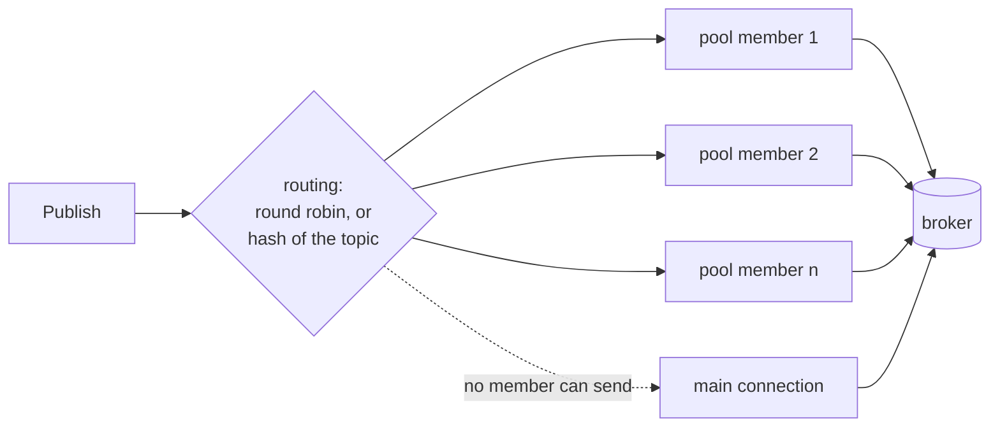

# Publish pool: `WithPublisherPool`

[Documentation](README.md) · [API reference](https://pkg.go.dev/github.com/ashtonian/mqttv5) · [Examples](../examples/README.md)

A broker lets each connection have at most its Receive Maximum QoS 1/2
publishes unacknowledged (by default 20 for mosquitto, 32 for EMQX, 10
for HiveMQ CE) and handles each connection's packets in order, so one
connection carries at most about Receive Maximum QoS 1/2 publishes per
round trip, however many goroutines call `Publish`. The pool opens n
more connections to the same broker, publish-only, each with a window
of its own, and spreads `Publish` calls over them. Only the main
connection subscribes: subscriptions, the Will, a persistent session
(`WithSessionExpiry`, `WithStore`), the lifecycle callbacks and
`QueuePublisher` stay on it, and a member leaves nothing on the broker
when it disconnects.



```go
cli, _ := mqttv5.New(
    mqttv5.WithBroker("mqtts://mqtt.example.com:8883"),
    mqttv5.WithClientID("telemetry-gw"),
    mqttv5.WithPublisherPool(4), // members telemetry-gw-pub-1 … -4
    mqttv5.WithPublisherPoolRouting(mqttv5.PoolRoutingHashByTopic),
)
```

`Publish` is called as it is without a pool.

- **When it helps.** When the round trip limits throughput: several
  goroutines publishing QoS 1 or 2 to a broker across a WAN, or to one
  slow to acknowledge. A nearby broker is limited by its own processing
  instead, and a pool adds little; QoS 0 has no window to widen.
  [`examples/pool`](../examples/pool) measures the difference against your
  broker.
- **Routing.** Each `Publish` goes out on one connection. Round robin
  (the default) takes the next member each call and may reorder a
  topic; `PoolRoutingHashByTopic` keeps each topic on one member, and so
  in order while that member stays connected.
- **Failure.** A member that cannot send (not connected, or its write
  queue full under `WriteDropNewest`) passes the message to the next;
  when none can, the main connection sends it, counted in
  `Stats().PoolFallbacks`. A broker refusal or ctx ending is returned as
  is, so a message never goes out twice. A member whose first CONNECT
  fails keeps retrying in the background; `Stats().PoolConnected` counts
  the members connected.
- **Guarantees.** Members have no session that outlives their
  connection: each connects with Session Expiry 0 (and Clean Start = 1
  the first time).
  A QoS 1/2 publish interrupted by a member's reconnect follows the
  session-loss policy — sent again, possibly duplicated, so QoS 2 is not
  exactly-once across it. Publish what must resume exactly on a
  connection with a session: a `QueuePublisher` always uses the main
  connection.
- **The broker's view.** Each member is a client of its own to the
  broker: n more connections against its connection limits, with
  ClientIDs `<ClientID>-pub-1` … `-n` that any ACL or policy keyed on
  the ClientID must admit (`WithPublisherPoolClientIDFn` changes them).
  A client without a ClientID leaves its members' to the broker too.
- **No Local.** A pooled publish comes from a member's ClientID, so a
  No Local subscription on the main connection receives it; only a
  publish that fell back to the main connection is held back. Mark your
  own messages (with a user property, say) and skip them in the handler
  instead.
- **Brokers.** Members use the client's broker list — `SetBrokers`
  replaces it for them too — and each starts at a random entry, so over
  a cluster the pool spreads across its nodes. Each member follows the
  server redirects its own broker sends.
- **Lifetime.** Members connect with the client and disconnect with
  it, never on their own: an idle member stays connected and sends
  keepalive pings. When the main connection drops, the members stay
  connected and publishing goes on. `Disconnect` refuses new publishes
  with `ErrClosed`, waits, bounded by its ctx, for those in flight on
  members (a member's session ends with its connection, so nothing could
  finish them later), then disconnects the members. A publish its ctx
  cuts short returns `ErrClosed`, and the broker may or may not have it;
  `Disconnect` then returns ctx's error.
- **Client-wide calls.** `Reauthenticate` re-authenticates every
  connected member along with the main connection, so the
  `Authenticator` must be safe for concurrent use. `Stats()` counts the
  members' connections and publishes with the main connection's.
  `Connected()`, `AwaitConnection` and the lifecycle callbacks report
  the main connection only.
- **Receiving and publishing apart.** A connection reads the
  acknowledgements of its own publishes on the same loop that runs
  `SubscribeCallback` handlers, `SubOnDrop` hooks and typed decoding,
  so on the main connection a slow handler holds up publishes too: with
  100 messages queued for a 10 ms handler, a QoS 1 publish waits about
  a second. A member reads its own acknowledgements and never waits on
  them, so its publishes don't wait — though a publish that falls back
  to the main connection does. Channel and queue subscriptions hand
  messages to their consumer without waiting for it; only their typed
  decoding and `SubOnDrop` / `SubOnDecodeError` hooks run on the loop.
- **A pool of one** adds no window, but is enough to keep publishes
  from waiting behind the subscriptions' handlers.

Members are configured from the parent: brokers, dialing, TLS,
credentials, authenticator, CONNECT properties, timeouts, buffer sizes,
write path, backoff, and the publish behaviour (`WithQoSDowngrade`,
`WithSessionLossPolicy`, `WithOutboundTopicAliases`,
`WithLenientDecoding`, `WithFollowServerRedirects`).
