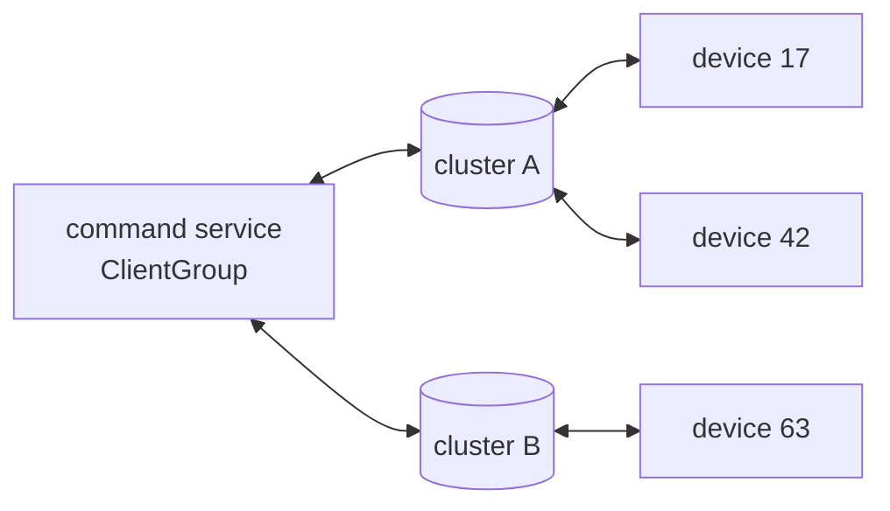
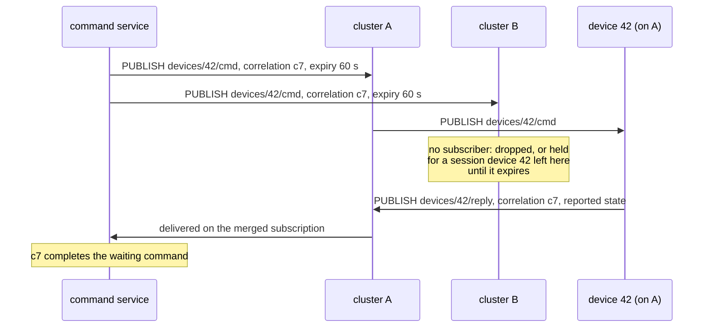
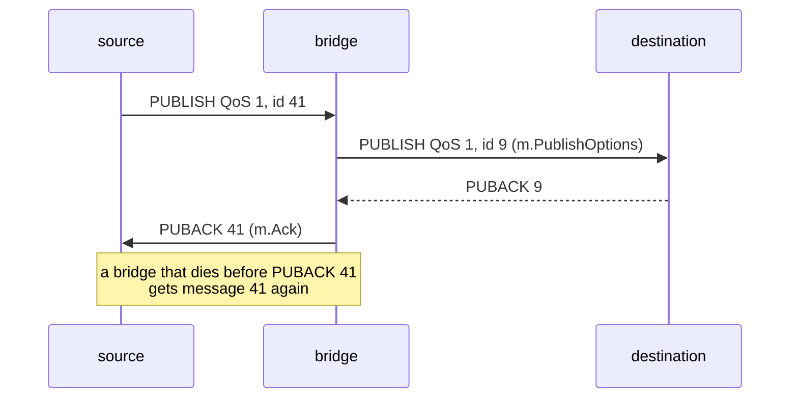
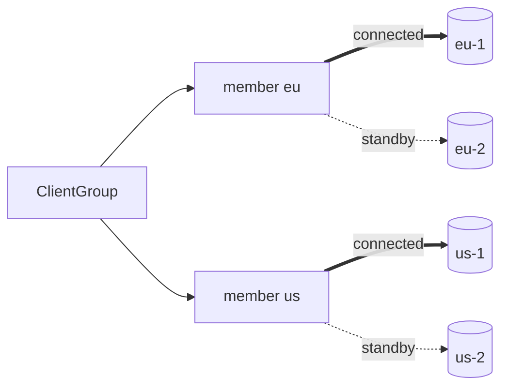

# Recipes

[Documentation](README.md) · [API reference](https://pkg.go.dev/github.com/ashtonian/mqttv5) · [Examples](../examples/README.md)

- [Central service over independent clusters](#central-service-over-independent-clusters)
- [At-least-once bridge](#at-least-once-bridge)
- [Regional HA](#regional-ha)
- [Quorum writes](#quorum-writes)
- [Sharding with fan-in](#sharding-with-fan-in)
- [Durable outbox](#durable-outbox)
- [Brokers from service discovery](#brokers-from-service-discovery)
- [Scaling out consumers](#scaling-out-consumers)

## Central service over independent clusters

Devices connect to either of two clusters, both always running, that
share no data. A cloud service sends them commands, or desired shadow
state, without knowing which cluster a device is on. The service keeps
a session on both: a `ClientGroup` with a member per cluster publishes
each command to both, and one merged subscription hears the devices'
replies from either.



```go
svc, _ := mqttv5.NewClientGroup(
    []mqttv5.GroupMember{
        {Name: "a", Brokers: []string{"mqtts://a-1.example.com:8883", "mqtts://a-2.example.com:8883"}},
        {Name: "b", Brokers: []string{"mqtts://b-1.example.com:8883", "mqtts://b-2.example.com:8883"}},
    },
    mqttv5.WithGroupSharedOpts(
        mqttv5.WithClientID("command-service"),
        mqttv5.WithCleanStart(false),
        mqttv5.WithSessionExpiry(60*60),
        mqttv5.WithRetryInitialConnect(), // a cluster down at start is tried again
    ),
    mqttv5.WithGroupSuccess(mqttv5.GroupSuccessAny), // one cluster down fails no command
)
// Replies from devices on either cluster, in one channel.
replies, _, _ := svc.Subscribe(ctx, []mqttv5.TopicFilter{{Topic: "devices/+/reply", QoS: 1}})
if err := svc.Connect(ctx); err != nil {
    log.Fatal(err)
}

// One command, to both clusters.
expiry := uint32(60)
_, err := svc.Publish(ctx, mqttv5.PublishOptions{
    Topic:                 "devices/42/cmd",
    QoS:                   1,
    Payload:               []byte(`{"desired":{"firmware":"1.4.2"}}`),
    CorrelationData:       []byte("c7"),
    MessageExpiryInterval: &expiry,
})
```

> **Acknowledge in the application.** MQTT's acknowledgements end at the
> broker: a QoS 1 PUBACK says cluster A has the command, not that device
> 42 — perhaps offline, perhaps on cluster B — acted on it. Close the
> loop as a device shadow or a command RPC does: the device answers each
> command with a reply carrying its Correlation Data (and, for a shadow,
> its reported state); the service resends until that reply arrives,
> devices act once per command ID and answer every copy, and an expiry
> keeps a copy no device collects from arriving much later.
> [`examples/group`](../examples/group) is the full program: the service's
> resend loop, the reply matching, and devices on two brokers, one of
> which comes online late.



## At-least-once bridge

Copy messages from one broker to another without losing any, even when
the bridge crashes: subscribe on the source with a channel, and ack each
message only once the destination has acknowledged its copy.



```go
src, _ := mqttv5.New(
    mqttv5.WithBroker("mqtts://plant.example.com:8883"),
    mqttv5.WithClientID("bridge-plant-3"),
    mqttv5.WithCleanStart(false),       // resume the source's session after a restart
    mqttv5.WithSessionExpiry(24*60*60), // the source holds messages while the bridge is down
)
dst, _ := mqttv5.New(
    mqttv5.WithBroker("mqtts://cloud.example.com:8883"),
    mqttv5.WithClientID("bridge-plant-3"),
)
// Subscribe before Connect, so the messages held for the bridge reach it.
msgs, _, _ := src.Subscribe(ctx, []mqttv5.TopicFilter{{Topic: "plant/#", QoS: 1}})
// Connect dst, then src, then:
for m := range msgs {
    if err := forward(ctx, dst, m); err != nil {
        return err // m stays unacked: the source delivers it again
    }
    _ = m.Ack()
}
```

```go
// forward publishes m on dst under "site-3/", waiting out dst's
// outages. It returns nil once dst has the message or refused it for
// good, and an error when ctx ends or dst is closed.
func forward(ctx context.Context, dst *mqttv5.Client, m *mqttv5.Message) error {
    opts := m.PublishOptions() // payload and properties as they arrived
    opts.Topic = "site-3/" + m.Topic
    for {
        err := dst.Publish(ctx, opts)
        switch {
        case err == nil:
            return nil
        case errors.Is(err, mqttv5.ErrNotConnected):
            if err = dst.AwaitConnection(ctx); err != nil {
                return err
            }
        case ctx.Err() != nil, errors.Is(err, mqttv5.ErrClosed):
            return err
        default:
            log.Printf("destination refused %s: %v", opts.Topic, err)
            return nil // drop it rather than hold up every message behind it
        }
    }
}
```

The source keeps the bridge's session, so messages that arrive while
the bridge is down wait for it, and any it received but never acked
come again when it reconnects or restarts
([durable consumers](subscribing.md#durable-consumers)). Never losing one costs the occasional
duplicate: after a crash, the source may deliver again a message the
destination already has.

This bridge forwards one message per destination round trip. For more,
store into a [`QueuePublisher`](durable-publishing.md#durable-publishing-with-queuepublisher)
on `queue/file` and ack the source once the message is on disk: the
queue keeps a window of messages in flight to the destination, retries
what can pass and dead-letters what cannot.

```go
out, _ := mqttv5.NewQueuePublisher(dst, q) // q from qfile.Open
for m := range msgs {
    opts := m.PublishOptions()
    opts.Topic = "site-3/" + m.Topic
    opts.QoS = max(opts.QoS, 1) // the queue takes QoS 1 and 2
    if err := out.Publish(ctx, opts); err != nil {
        return err // not stored: the source delivers it again
    }
    _ = m.Ack()
}
```

To spread the load, run several bridges on a shared subscription
(`$share/bridge/plant/#`): the source hands each message to one of
them.

## Regional HA

A `ClientGroup` whose members each fail over within their own region:
a broadcast publish reaches every region, and a broker going down moves
only its region's member.



```go
g, _ := mqttv5.NewClientGroup(
    []mqttv5.GroupMember{
        {Name: "eu", Brokers: []string{"mqtts://eu-1.example.com:8883", "mqtts://eu-2.example.com:8883"}},
        {Name: "us", Brokers: []string{"mqtts://us-1.example.com:8883", "mqtts://us-2.example.com:8883"}},
    },
    mqttv5.WithGroupSharedOpts(mqttv5.WithClientID("pricing")),
    mqttv5.WithGroupSuccess(mqttv5.GroupSuccessAny),
)
```

With `GroupSuccessAny`, a publish succeeds while any region takes it;
`results` says which did not.

## Quorum writes

Write to independent brokers and succeed once enough of them have the
message:

```go
g, _ := mqttv5.NewClientGroup(members, // three independent brokers
    mqttv5.WithGroupSuccess(mqttv5.GroupSuccessQuorum(2)),
)
results, err := g.Publish(ctx, mqttv5.PublishOptions{Topic: "ledger/tx", QoS: 1, Payload: p})
// err is nil once two of the three acknowledged; results has each one's outcome
```

`Publish` returns when every member has answered, so ctx bounds how
long a slow broker can hold the call.

## Sharding with fan-in

Spread topics over an unclustered fleet, each topic always on the same
broker, and consume all of them through one subscription:

```go
// Publishers: each topic goes to the same broker while it is connected.
pubs, _ := mqttv5.NewClientGroup(shards,
    mqttv5.WithGroupSharedOpts(mqttv5.WithClientID("orders-pub")),
    mqttv5.WithGroupPublishPolicy(mqttv5.GroupPublishHashByTopic),
)

// Consumers: one merged subscription across every shard; each Ack goes
// back to the broker that delivered the message.
subs, _ := mqttv5.NewClientGroup(shards, mqttv5.WithGroupSharedOpts(mqttv5.WithClientID("orders-sub")))
msgs, tokens, _ := subs.Subscribe(ctx, []mqttv5.TopicFilter{{Topic: "orders/#", QoS: 1}})
```

While a shard's broker is down, its topics pass to the next member.
Consumers subscribed to every shard still receive them, but a topic's
order is not kept across the switch.

## Durable outbox

Publish through outages, broker failovers and process restarts:
`QueuePublisher` on `queue/file`, the session in `store/file`, and a
broker list.

```go
st, _ := sfile.Open("/var/lib/gateway/session")
q, _ := qfile.Open("/var/lib/gateway/outbound")
cli, _ := mqttv5.New(
    mqttv5.WithBrokers("mqtts://mqtt-1.example.com:8883", "mqtts://mqtt-2.example.com:8883"),
    mqttv5.WithClientID("gateway-12"),
    mqttv5.WithStore(st),
    mqttv5.WithRetryInitialConnect(),
)
pub, _ := mqttv5.NewQueuePublisher(cli, q, mqttv5.WithQueueIdempotencyKey())
```

`pub.Publish` returns once the message is on disk, whether a broker is
up or not. A restarted process continues the exchanges in flight
instead of publishing those messages again. Across a failover between
nodes of a cluster the session continues too; between independent
brokers the failover is a session loss and in-flight messages go out
again, so `WithQueueIdempotencyKey` adds the `mqttv5-msg-id` user
property for consumers to drop the copy.

## Brokers from service discovery

```go
// watchBrokers keeps cli's broker list at the _mqtt._tcp SRV records
// of example.com, checked every minute.
func watchBrokers(ctx context.Context, cli *mqttv5.Client) {
    tick := time.NewTicker(time.Minute)
    defer tick.Stop()
    for {
        _, srvs, err := net.DefaultResolver.LookupSRV(ctx, "mqtt", "tcp", "example.com")
        if err == nil {
            urls := make([]string, 0, len(srvs))
            for _, s := range srvs {
                urls = append(urls, "mqtt://"+net.JoinHostPort(strings.TrimSuffix(s.Target, "."), strconv.Itoa(int(s.Port))))
            }
            err = cli.SetBrokers(urls...)
        }
        if err != nil {
            log.Printf("broker list unchanged: %v", err)
        }
        select {
        case <-ctx.Done():
            return
        case <-tick.C:
        }
    }
}
```

`SetBrokers` leaves the connection in use alone; the new list applies
from the next connection attempt.

## Scaling out consumers

Several instances of a service share the work of one subscription: the
broker hands each message to one of them ([§4.8.2]).

```go
// In every instance:
jobs, _, _ := cli.Subscribe(ctx, []mqttv5.TopicFilter{{Topic: "$share/workers/jobs/#", QoS: 1}})
```

When an instance dies holding a message it never acked, the broker
may, at QoS 1, wait for that instance to come back or hand the message
to another; at QoS 2 it waits, and the message is lost if the
instance's session expires first. Make each instance a
[durable consumer](subscribing.md#durable-consumers) so it comes back for it.

<!-- MQTT v5.0 citations -->

[§4.8.2]: https://docs.oasis-open.org/mqtt/mqtt/v5.0/os/mqtt-v5.0-os.html#_Toc3901250 "4.8.2 Shared Subscriptions"
